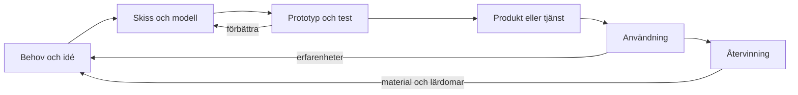

# Kapitel 1: Från idé till återvinning

> **I det här kapitlet lär du dig**
> - vad teknik är och varför tekniker arbetar i en process
> - teknikutvecklingsprocessens delar och hur de påverkar varandra
> - strategier för att lösa tekniska problem
> - hur du väljer mellan olika lösningar med en viktad matris
> - hur du planerar och driver ett projekt

Tänk på något enkelt, till exempel hållaren du snart ska konstruera till ditt elektronikkort. Någon måste komma på den, rita den, tillverka den, testa den och till sist ta hand om den när den inte behövs längre. Varje beslut längs vägen påverkar något annat: väljer du en tunn vägg sparar du material, men kanske går hållaren sönder. Hela den kedjan är vad den här kursen handlar om.

## Vad är teknik?

**Teknik** är människans sätt att lösa behov och önskemål genom att omvandla resurser till produkter, tjänster och system. En hammare är teknik, men det är också en tidtabell, en webbplats och elnätet. Teknik är alltså inte bara prylar utan också kunskapen om hur man gör och de system som håller ihop allt.

Ämnet är **tvärvetenskapligt**, det vill säga att det hämtar kunskap från flera håll samtidigt: fysik, matematik, programmering, ekonomi, miljö och människors beteende. Därför kommer du i kursen att växla mellan linjal, CAD-program, kod, formler och diskussioner om vem tekniken är till för.

## Teknikutvecklingsprocessen

**Teknikutvecklingsprocessen** är den väg en lösning tar från första tanke till slutet av sitt liv. Den kan delas upp på många sätt. I den här boken använder vi sex steg.

| Steg | Frågan du ställer | Exempel från kursen |
|------|-------------------|---------------------|
| Behov och idé | Vilket problem löser jag, och för vem? | Korten måste sitta stadigt men gå att ta ut |
| Skiss och modell | Hur kan det se ut och fungera? | Skiss på papper, 3D-modell i Onshape |
| Prototyp och test | Fungerar det i verkligheten? | Första utskriften: passar kortet? |
| Produkt eller tjänst | Är den färdig och går den att upprepa? | Hållaren med godkänd passform |
| Användning | Vad händer när någon använder den? | Hållaren sitter på robotbilen och skakar |
| Återvinning | Vad händer sedan? | Plasten sorteras, kortet används igen |

Pilarna bakåt är det viktigaste i figuren. Att gå tillbaka och förbättra är inte ett misslyckande, det är så processen fungerar. De val du gör tidigt låser också mycket av det som kommer sedan. Bestämmer du materialet i skissen har du samtidigt bestämt en stor del av hur produkten kan återvinnas.

Betygskriterierna frågar just efter hur delarna **samverkar och påverkar resultatet**. Det räcker alltså inte att kunna rada upp stegen. Du behöver kunna säga: "Jag ändrade väggtjockleken efter testet, och det gjorde att hållaren klarade montering men blev 0,8 g tyngre."

## Strategier för att lösa tekniska problem

När något inte fungerar är det frestande att ändra flera saker på en gång. Då vet du aldrig vad som hjälpte. Använd i stället en strategi.

1. **Beskriv problemet exakt.** "Det funkar inte" går inte att lösa. "Temperaturen visar alltid 0,0" går att undersöka.
2. **Dela upp problemet.** Är felet i koden, i kopplingen eller i komponenten?
3. **Ställ en hypotes**, alltså en gissning som går att testa.
4. **Ändra en sak i taget** och testa efter varje ändring.
5. **Anteckna** vad du provade och vad som hände.
6. **Fråga om hjälp** med tydlig information: vad du förväntade dig och vad som hände i stället.

Andra användbara strategier är att börja med den enklaste versionen som går att testa, att jämföra med något som fungerar (till exempel kompisens komponent) och att skissa innan du bygger.

## Att välja mellan lösningar

Ofta finns flera lösningar som alla fungerar. Då hjälper en **viktad beslutsmatris**. Du väljer kriterier, ger varje kriterium en vikt efter hur viktigt det är, och poängsätter lösningarna.

**Genomräknat exempel.** Tre idéer till en hållare ska jämföras, med poäng 1 till 5.

| Kriterium | Vikt | A: öppen ram | B: låda med lock | C: platta med klämmor |
|-----------|-----:|-------------:|-----------------:|----------------------:|
| Funktion | 5 | 4 | 5 | 3 |
| Går att skriva ut | 4 | 4 | 2 | 5 |
| Lite material | 3 | 5 | 2 | 4 |
| Lätt att montera | 2 | 3 | 4 | 4 |

Beräkning för A: 5·4 + 4·4 + 3·5 + 2·3 = 20 + 16 + 15 + 6 = **57**.
För B: 25 + 8 + 6 + 8 = **47**. För C: 15 + 20 + 12 + 8 = **55**.
Högsta möjliga är 5·(5 + 4 + 3 + 2) = 70.

A vinner, men bara knappt över C. Matrisen ger inte facit. Den tvingar dig att skriva ned vad du tycker är viktigt, så att någon annan kan granska hur du tänkte. Om du höjer vikten på "Lätt att montera" kan C vinna, och det är värt att fundera över varför.

## Att arbeta i projekt

Ett **projekt** är ett arbete med ett bestämt mål, en tidsgräns och begränsade resurser. I kursen gör du två större projekt, I hetaste laget och Driverbot. Så här får du dem att gå ihop:

- Skriv målet och kraven först. Ett **krav** är något som går att kontrollera, till exempel "max 6 000 mm³".
- Dela arbetet i delmål och uppskatta tiden för varje del.
- Planera för att saker tar längre tid än du tror, särskilt utskrifter och felsökning.
- Dokumentera under arbetets gång, inte efteråt.

**Entreprenörskap** betyder i den här kursen att omsätta en idé till handling: att se ett behov, våga prova och ta ansvar för att något blir gjort. Du behöver inte starta företag för att tänka så.

## Begrepp

- **Teknik:** människans sätt att lösa behov genom att omvandla resurser till produkter, tjänster och system.
- **Teknikutvecklingsprocessen:** vägen från idé och modell via produkt till användning och återvinning.
- **Prototyp:** en tidig version som byggs för att testa en idé.
- **Krav:** en kontrollerbar egenskap som lösningen måste ha.
- **Hypotes:** en gissning om orsaken till något, som går att testa.
- **Viktad beslutsmatris:** tabell där lösningar poängsätts mot viktade kriterier.
- **Projekt:** arbete med mål, tidsgräns och begränsade resurser.

## Testa dig själv

1. Varför räknas en tidtabell som teknik?
2. Nämn de sex stegen i processen och ge ett eget exempel på varje.
3. Hur kan ett beslut i skissteget påverka återvinningen?
4. Varför ska du bara ändra en sak i taget när du felsöker?
5. Vad är skillnaden mellan ett krav och en önskan?
6. Vad är styrkan och svagheten med en viktad beslutsmatris?

## Koppling till projektet

Processen genomsyrar alla projekt. Du följer den första gången i [Ritteknik, CAD och 3D-print](../projekt/ritteknik-cad-3d-print/README.md) och tar den hela vägen i [I hetaste laget](../projekt/hetaste-laget/README.md) och [Produktutveckling: Driverbot](../projekt/produktutveckling-driverbot/README.md). Spara dina anteckningar om vad du ändrade och varför, för det är just det som visar att du förstår processen.

## Läs mer

- [Kursintroduktionen](../Teknik%201%20-%20Kursintroduktion.pptx): kursens moment och röda tråd.
- [Kursplanen i den här boken](../kursplan.md): vad du ska kunna och hur du bedöms.

[← Föregående](../README.md) | [Innehåll](../README.md) | [Nästa →](02-ritteknik.md)
