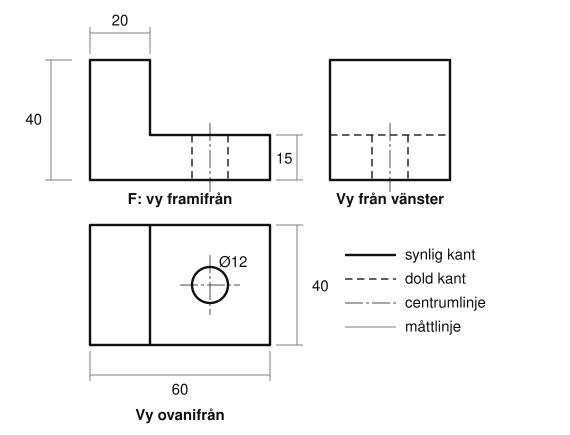

# Kapitel 2: Ritteknik

> **I det här kapitlet lär du dig**
> - varför tekniska ritningar följer standarder
> - vilka linjetyper som används och vad de betyder
> - hur du placerar tre vyer rätt med vältmetoden
> - hur du måttsätter med kedje- och baslinjemått
> - hur du använder skala och kontrollerar att ritningen stämmer

Tänk dig att du skickar en detalj för tillverkning till någon du aldrig träffat, i ett land där ni inte talar samma språk. Ritningen måste ändå bli rätt tolkad. Det är därför ritteknik är ett språk med regler. När du kan det språket kan du både beskriva dina egna idéer och läsa andras.

## Ritningen som dokument

En teknisk ritning är ett standardiserat sätt att beskriva en produkt. Den är **tillverkningsunderlag**, alltså det som den som tillverkar arbetar efter. Den kan också vara ett juridiskt dokument: om en leverans inte stämmer är det ritningen som visar vad som var beställt.

En bra ritning är:

- tydlig och lätt att förstå, med lättläst text och lättlästa mått
- **entydig**, det vill säga att den bara kan tolkas på ett sätt
- begränsad till nödvändiga uppgifter
- ritad så att föremålet visas i färdigt skick
- gjord enligt standard

En **standard** är en gemensam överenskommelse om hur något ska göras. Svensk standard ges ut av SIS och internationell av ISO. Tack vare standarderna ritar i princip alla på samma sätt, och missförstånd undviks.

## Linjetyper

Linjernas utseende bär information. De vanligaste är:

| Linje | Utseende | Betyder |
|-------|----------|---------|
| Grov heldragen | tjock och hel | synliga kanter |
| Streckad | korta streck | dolda kanter |
| Tunn streckprickad | långa och korta streck | centrumlinjer och symmetrilinjer |
| Tunn heldragen | tunn och hel | måttlinjer och måttgränslinjer |

En vanlig nybörjarmiss är att rita allt med samma linje. Då går det inte att se skillnad på en kant och ett mått.

## Tre vyer

Ett föremål har tre dimensioner, men papperet bara två. Lösningen är att visa föremålet från flera håll. Oftast räcker tre **vyer**: framifrån, ovanifrån och från sidan.

Vi använder **vältmetoden**, som också kallas europeisk projektion. Tänk att föremålet står på bordet och att du välter det. Vyn framifrån, F, ritas först och placeras längst upp till vänster på papperet.

- Vältar du föremålet framåt, mot dig, ser du dess ovansida. Den vyn placeras **under** F.
- Vältar du föremålet åt höger ser du dess vänstra sida. Den vyn placeras **till höger om** F.

Vyerna ska ligga i linje med varandra. Höjder stämmer mellan F och sidovyn, bredder stämmer mellan F och vyn ovanifrån.

**Genomgånget exempel.** Figuren visar en L-formad detalj: en bottenplatta som är 60 mm bred, 40 mm djup och 15 mm hög, med en uppstickande del till vänster som är 20 mm bred och 40 mm hög. Genom plattan går ett hål med diametern 12 mm.

Följ hålet genom vyerna. Ovanifrån syns det som en cirkel, eftersom du tittar rakt ned i det. Framifrån och från sidan är det gömt inne i materialet och ritas därför med streckade linjer. Den tunna streckprickade linjen visar hålets mitt. Från vänster döljer den höga delen plattans ovansida, så även den kanten blir streckad.

## Måttsättning

Ritningen måste innehålla alla mått som behövs för att tillverka detaljen, men varje mått ska bara stå en gång. Mått anges i millimeter utan enhet, och en måttlinje ska sitta utanför figuren om det går.

Det finns två vanliga sätt att måttsätta en rad med hål eller kanter:

- **Kedjemått:** varje mått utgår från det förra.
- **Baslinjemått:** alla mått utgår från samma kant.

Skillnaden märks när tillverkningen inte blir exakt, vilket den aldrig blir. Den tillåtna avvikelsen från ett mått kallas **tolerans**.

**Genomräknat exempel.** Fyra hål ska sitta 15 mm från varandra längs en rad. Varje mått får avvika ±0,1 mm.

- Med kedjemått kan felen läggas ihop. Det sista hålet kan i värsta fall hamna 4 · 0,1 = **0,4 mm** fel.
- Med baslinjemått anges hålen som 15, 30, 45 och 60 mm från samma kant. Varje hål kan då högst hamna **0,1 mm** fel.

Är det viktigt att det sista hålet hamnar rätt mot en annan detalj väljer du baslinjemått. Kedjemått passar när avståndet mellan två grannar är det viktiga.

## Skala

Allt får inte plats i verklig storlek. **Skala** anger förhållandet mellan måttet på ritningen och det verkliga måttet.

- Skala 1:2 betyder att ritningen är hälften så stor. En 200 mm lång detalj blir 200 / 2 = 100 mm på papperet.
- Skala 5:1 betyder att ritningen är fem gånger större. En 8 mm lång detalj blir 8 · 5 = 40 mm på papperet.

Måtten du skriver ut är alltid de **verkliga** måtten, oavsett skala. Annars skulle tillverkaren bygga fel storlek.

## Skiss och snitt

Allt behöver inte vara en perfekt ritning. En **skiss** är en snabb frihandsbild som hjälper dig tänka och prata med andra. Den ska vara begriplig, inte vacker. I kursen skissar du alltid på papper innan du öppnar CAD-programmet, eftersom det är billigare att ändra sig på papper.

Vissa detaljer är svåra att förstå med streckade linjer. Då kan man rita ett **snitt**, som visar hur föremålet ser ut om det skärs igenom. Du möter snitt kort här och kommer att se det igen i CAD.

## Begrepp

- **Ritning:** standardiserad bild som beskriver en produkt och används som tillverkningsunderlag.
- **Standard:** gemensam överenskommelse om hur något ska utföras, till exempel från SIS eller ISO.
- **Vy:** bild av föremålet från ett bestämt håll.
- **Vältmetoden:** sätt att placera vyerna enligt europeisk projektion.
- **Kedjemått:** mått som utgår från det föregående måttet.
- **Baslinjemått:** mått som alla utgår från samma linje eller kant.
- **Tolerans:** tillåten avvikelse från ett mått.
- **Skala:** förhållandet mellan ritningens mått och verkliga mått.

## Testa dig själv

1. Varför kan en ritning ha betydelse i en rättslig tvist?
2. Vad betyder det att en ritning är entydig?
3. Var placeras vyn ovanifrån i förhållande till F, och varför?
4. Vilken linjetyp använder du för ett hål som inte syns från det håll du ritar?
5. När är baslinjemått bättre än kedjemått?
6. Vilket mått skriver du på ritningen om du ritar i skala 1:2 och detaljen är 80 mm lång?

## Övningar

**Grund.** Rita detaljerna i [Träning, vyer och måttsättning](../Ritteknik%20och%20Inventor/Tr%C3%A4ning%2C%20vyer%20och%20m%C3%A5tts%C3%A4ttning.docx) i tre vyer på rutat papper med linjal. Börja med F längst upp till vänster.

**Grund.** En detalj är 150 mm lång. Hur lång blir den på ritningen i skala 1:5? Och i skala 2:1?

Svar

150 / 5 = 30 mm i skala 1:5 och 150 · 2 = 300 mm i skala 2:1.

**Vidare.** Fem hål måttsätts med kedjemått där varje mått har toleransen ±0,05 mm. Hur stort kan felet bli som mest mellan första och femte hålet? Tänk på hur många mått som ligger mellan hålen.

Svar

Mellan fem hål finns fyra mått, så felet kan bli 4 · 0,05 = 0,2 mm.

**Utmaning.** Mät ett föremål hemma med linjal eller skjutmått och gör en fullständig ritning i tre vyer. Byt ritning med en kompis och låt kompisen beskriva föremålet utan att ha sett det. Vad var otydligt?

## Koppling till projektet

Det här är första delen av [Ritteknik, CAD och 3D-print](../projekt/ritteknik-cad-3d-print/README.md). Skissen och de måttsatta vyerna är också grunden för din hållare, som är kursens första examinerande uppgift.

## Läs mer

- [Rittekniks presentation](../Ritteknik%20och%20Inventor/Ritteknik%20presentation.pptx) med vyer och måttsättning.
- [Materialmappen för ritteknik och Inventor](../Ritteknik%20och%20Inventor/) med övningsblad och Klosshäftet.
- [SIS, Svenska institutet för standarder](https://www.sis.se).

[← Föregående](01-teknikutvecklingsprocessen.md) | [Innehåll](../README.md) | [Nästa →](03-cad-och-inventor.md)
