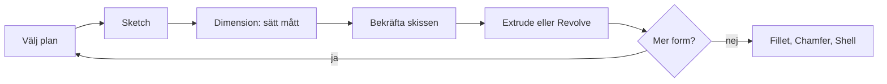

# Kapitel 3: CAD och modellering i Onshape

> **I det här kapitlet lär du dig**
> - vad CAD och parametrisk modellering är
> - hur ett dokument i Onshape är uppbyggt med flikarna Part Studio, Assembly och Drawing
> - hur en detalj byggs upp av skisser och features
> - vilka verktyg i Onshape du behöver först
> - hur du räknar ut och kontrollerar volymen på en modell
> - hur du delar en modell och sparar versioner av den
> - varför modeller används för att testa idéer

Föreställ dig att du har ritat en hållare för hand och upptäcker att kortet är 2 mm bredare än du trodde. På papper får du sudda och rita om allt. I ett CAD-program ändrar du ett enda tal, och hela modellen uppdateras. Det är skälet till att nästan all modern konstruktion sker digitalt.

## Vad är CAD?

**CAD** står för Computer Aided Design, datorstödd konstruktion. I kursen använder vi Onshape, som är en **parametrisk** modellerare som körs i webbläsaren. Parametrisk betyder att modellens form styrs av mått, och att måtten kan hänga ihop med varandra.

**Exempel.** Med verktyget **Variable** skapar du en variabel som heter `bredd` och ger den värdet 100 mm. Du ritar en rektangel och skriver `#bredd` på första sidan. Den andra sidan sätter du inte till 50 utan till `#bredd/2`. Ändrar du sedan `bredd` till 120 blir den andra sidan automatiskt 60 mm. Det är så du bygger in dina tankar om konstruktionen i själva modellen. Variabelnamn får bara innehålla engelska bokstäver, siffror och understreck, så skriv till exempel `hojd` utan ö. Variabeln måste också ligga före den skiss eller feature som använder den.

En modell är en **modell** i teknisk mening: en förenklad beskrivning av verkligheten som låter dig undersöka något utan att bygga det. Du kan mäta den, ändra den och se hur delar passar ihop, och det kostar nästan ingenting. Det kallas ibland digital **prototypning**. Det är en form av modellering och simulering, men den ersätter inte att testa i verkligheten. Plast krymper, skruvar glappar och människor använder saker på sätt du inte tänkt på.

## Att arbeta i molnet

Onshape installeras inte på datorn. Du loggar in i webbläsaren, och dina modeller ligger i molnet. Det betyder att du måste ha nätverk och ett konto för att arbeta, och att du kommer åt ditt arbete från en annan dator när du loggar in där. Läraren berättar hur du får ditt konto.

Allt arbete ligger i ett **dokument**. Ett dokument är inte en fil utan en samling flikar längst ned på skärmen:

| Flik | Vad du gör där |
|------|----------------|
| Part Studio | Skissar och modellerar. En Part Studio kan innehålla flera delar som hör ihop. |
| Assembly | Sätter ihop delar och kontrollerar att de passar och rör sig rätt. |
| Drawing | Gör en ritning med vyer och mått. |

Ett nytt dokument börjar med en Part Studio och en Assembly. Du behöver aldrig spara, för varje ändring hamnar automatiskt i dokumentets historik.

## Så byggs en detalj upp

Onshape beskriver detaljer ungefär som när man bygger med Lego. Du börjar med ett plan, gör en grundform och lägger sedan till eller tar bort material.

| Begrepp | Vad det är |
|---------|------------|
| Plan | Den yta du börjar rita på, till exempel Top eller Front |
| Sketch | En tvådimensionell skiss med linjer, cirklar och mått |
| Feature | En 3D-operation, till exempel en extrudering eller ett hål |
| Part | En färdig detalj, listad i Parts-listan i Part Studio |

Varje skiss och feature hamnar i **Feature list** till vänster. Listan är modellens historia från första skissen till sista rundningen. Du ändrar något genom att dubbelklicka på raden, eller högerklicka och välja **Edit**. Med **Rollback bar**, det tjocka strecket i listan, kan du dra tillbaka modellen och se hur den såg ut tidigare.

Skissens färger visar om den är färdig. **Svart** betyder att den är helt bestämd, **blå** att mått eller villkor saknas och **röd** att villkoren krockar. Bekräfta skissen med bocken i dialogrutan innan du går vidare.

## Verktygen du börjar med

- **Extrude** drar ut ett slutet område i en skiss till en kropp. Som **New** skapar den en ny del, som **Add** lägger den till material och som **Remove** skär den bort material, och då blir det ett hål.
- **Mirror** speglar en del över ett plan eller en plan yta. Lägg gärna modellen så att ett av planen hamnar i mitten, så har du ett färdigt spegelplan.
- **Revolve** roterar en halv profil runt en axel och ger en rotationskropp, till exempel en flaska.
- **Fillet** rundar av en kant och **Chamfer** gör en fas, alltså en sned kant.
- **Linear Pattern** och **Circular Pattern** upprepar en feature i ett mönster. Den feature som upprepas kallas ofta frö.
- **Shell** holkar ur en kropp så att det blir ett skal med bestämd väggtjocklek. Du väljer vilka ytor som ska vara öppna och skriver in tjockleken.

Tänk efter före. Från vilket håll är det smartast att börja modellera? Var ska origo ligga? Bra CAD-arbete kännetecknas av tålamod, noggrannhet och vilja att experimentera.

En vanlig orsak till fel är en skiss som inte är sluten, för då finns det inget område att extrudera. Blir en rad röd i Feature list är det första steget att öppna den och läsa vad Onshape klagar på.

## Kontrollera modellen

Onshape kan mäta. Välj en yta eller kant, så visas måtten nere till höger i verktyget **Measure**.

Volymen läser du av med **Mass properties**. Hållaren får vara högst 6 000 mm³, så det här behöver du göra:

1. Se till att dokumentet räknar i millimeter. Du ställer in det under **Workspace units** i dokumentmenyn.
2. Högerklicka på delen i Parts-listan och välj **Assign material**. Välj ett material, annars tar verktyget inte med delen i beräkningen.
3. Klicka på ikonen för Mass properties nere till höger, välj delen och läs av **Volume** under fliken Part.

Kontrollera alltid om ett resultat är rimligt. Det kallas **rimlighetsbedömning** och betyder att du med en enkel uppskattning undersöker om ett svar kan stämma.

**Genomräknat exempel 1: skal.** En kloss är 100 × 80 × 40 mm. Du gör den ihålig med Shell och väggtjockleken 2 mm, med öppningen uppåt.

- Yttre volym: 100 · 80 · 40 = 320 000 mm³.
- Inre mått blir 96 × 76 × 38 mm, eftersom det dras bort 2 mm på vardera sida men bara botten på höjden.
- Inre volym: 96 · 76 · 38 = 277 248 mm³.
- Volym plast: 320 000 − 277 248 = **42 752 mm³**, ungefär 13 procent av den ursprungliga klossen.

**Genomräknat exempel 2: går hållaren under gränsen?** En förenklad hållare består av en ram och ett tumgrepp. Måtten är påhittade för att visa räkningen, så dina egna blir andra.

- Ramen är 100 × 60 mm utvändigt och 84 × 44 mm invändigt, 2 mm tjock.
- Ramens yta: 100 · 60 − 84 · 44 = 6 000 − 3 696 = 2 304 mm².
- Ramens volym: 2 304 · 2 = 4 608 mm³.
- Tumgreppet är 25 × 15 × 2 mm, alltså 750 mm³.
- Totalt: 4 608 + 750 = **5 358 mm³**.

Det är 642 mm³ under gränsen på 6 000 mm³, ungefär 11 procent marginal. Visar Onshape något helt annat, till exempel 50 000 mm³, har du troligen en inre del som inte blivit borttagen eller fel mått.

## Färdiga modeller

Ofta bygger du runt något som redan finns, till exempel ett kretskort eller en motor. Filer i formatet STEP (`.step` eller `.stp`) tar du in genom att klicka på plusset längst ned till vänster och välja **Import**. Onshape kan också importera `.ipt`-filer på samma sätt. Varje importerad fil blir en egen flik i dokumentet. En importerad modell saknar Feature list, så du kan mäta den och bygga runt den men inte ändra hur den är uppbyggd.

## Från modell till underlag

En modell i Onshape kan bli en ritning. Högerklicka på delen i Parts-listan och välj **Create drawing of**, så skapas en Drawing-flik med vyer som du kan måttsätta.

Till 3D-skrivaren exporterar du delen. Hur det går till beskrivs i [kapitel 4](04-3d-utskrift.md). Du kan också ge delen färg och material via högerklicksmenyn och ta skärmbilder till dokumentation och presentationer. Bra namn är en del av dokumentationen, så döp dokumentet, flikarna och delarna så att du och andra kan hitta dem igen.

## Dela och spara versioner

Eftersom modellen ligger i molnet skickar du inga filer. Du delar i stället dokumentet.

- **Share** öppnar en dialog där du bjuder in någon och väljer om personen får ändra (**Can edit**) eller bara titta (**Can view**).
- Under **Share** kan du också kopiera en länk. Länken ger läsbehörighet, och alla som har länken kommer åt modellen, så tänk på vem du skickar den till.
- Flera kan arbeta i samma dokument samtidigt, och ändringarna syns direkt för alla. En Drawing-flik kan däremot bara redigeras av en person åt gången.
- **Versions and history** visar allt som hänt i dokumentet. Du kan gå tillbaka till en tidigare punkt. Med **Create version** sparar du ett namngivet läge som inte kan ändras, till exempel "Klar för utskrift".

Skapa gärna en version innan du lämnar in, så att läraren ser precis det du är nöjd med. Dela sedan dokumentet med läraren eller lämna in på det sätt läraren anger.

## Begrepp

- **CAD:** datorstödd konstruktion.
- **Parametrisk modellering:** modellering där formen styrs av mått som kan hänga ihop.
- **Dokument:** samling av flikar där all din modell ligger i molnet.
- **Part Studio:** flik där du skissar och modellerar en eller flera delar.
- **Sketch:** tvådimensionell skiss i ett plan.
- **Feature:** en 3D-operation i modellen.
- **Feature list:** lista över skisser och features i den ordning de gjordes.
- **Part:** en enskild detalj.
- **Shell:** verktyg som holkar ur en kropp.
- **Version:** ett sparat, namngivet läge av dokumentet som inte går att ändra.
- **Rimlighetsbedömning:** kontroll av om ett resultat kan stämma.

## Koppling till projektet

CAD är kärnan i [Ritteknik, CAD och 3D-print](../projekt/ritteknik-cad-3d-print/README.md). Där modellerar du hållaren runt baskortet. Filen [Baskort.ipt](../H%C3%A5llare/Baskort.ipt) importerar du till ditt dokument, och så använder du Measure för att mäta kortet. Du återanvänder hållaren sedan i I hetaste laget och i Driverbot.

## Läs mer

- [Uppgiften Hållare](../H%C3%A5llare/H%C3%A5llare%20esp%20mm.docx). Uppgiftsbeskrivningen är skriven för ett annat CAD-program. Kraven gäller, men kommandona heter något annat, så följ det här kapitlet.
- [Onshapes resurser för elever](https://www.onshape.com/en/education/student-resources)
- [Part Studios i Onshapes hjälp](https://cad.onshape.com/help/Content/PartStudio/part_studios.htm)
- [Mass properties i Onshapes hjälp](https://cad.onshape.com/help/Content/View/mass_properties_tool.htm)
- [Importera filer i Onshapes hjälp](https://cad.onshape.com/help/Content/Document/importing_files.htm)

[← Föregående](02-ritteknik.md) | [Innehåll](../README.md) | [Nästa →](04-3d-utskrift.md)
