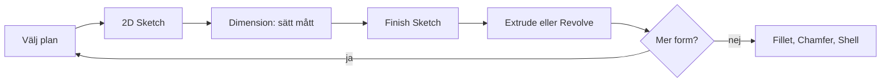

# Kapitel 3: CAD och modellering i Inventor

> **I det här kapitlet lär du dig**
> - vad CAD och parametrisk modellering är
> - hur en detalj byggs upp av skisser och features
> - vilka verktyg i Inventor du behöver först
> - hur du räknar ut och kontrollerar volymen på en modell
> - varför modeller används för att testa idéer

Föreställ dig att du har ritat en hållare för hand och upptäcker att kortet är 2 mm bredare än du trodde. På papper får du sudda och rita om allt. I ett CAD-program ändrar du ett enda tal, och hela modellen uppdateras. Det är skälet till att nästan all modern konstruktion sker digitalt.

## Vad är CAD?

**CAD** står för Computer Aided Design, datorstödd konstruktion. I kursen använder vi Autodesk Inventor, som är en **parametrisk** modellerare. Det betyder att modellens form styrs av mått, och att måtten kan hänga ihop med varandra.

**Exempel.** Du ritar en rektangel och sätter första sidan till 100 mm. Inventor döper måttet till `d0`. Den andra sidan sätter du inte till 50 utan till `d0/2`. Ändrar du sedan `d0` till 120 blir den andra sidan automatiskt 60 mm. Det är så du bygger in dina tankar om konstruktionen i själva modellen.

En modell är en **modell** i teknisk mening: en förenklad beskrivning av verkligheten som låter dig undersöka något utan att bygga det. Du kan mäta den, ändra den och se hur delar passar ihop, och det kostar nästan ingenting. Det kallas ibland digital **prototypning**. Det är en form av modellering och simulering, men den ersätter inte att testa i verkligheten. Plast krymper, skruvar glappar och människor använder saker på sätt du inte tänkt på.

## Så byggs en detalj upp

Inventor beskriver detaljer ungefär som när man bygger med Lego. Du börjar med ett plan, gör en grundform och lägger sedan till eller tar bort delar.

| Begrepp | Vad det är |
|---------|------------|
| Plan | Den yta du börjar rita på, till exempel XZ |
| Sketch | En tvådimensionell skiss med linjer, cirklar och mått |
| Feature | En 3D-operation, till exempel en extrudering eller ett hål |
| Part | Den färdiga detaljen, sparad som `.ipt` |

## Verktygen du börjar med

- **Extrude** drar ut en sluten skiss till en kropp. Samma verktyg kan också skära bort material, och då blir det ett hål.
- **Mirror** speglar en form över en symmetrilinje. Lägg gärna figuren så att origo hamnar i mitten.
- **Revolve** roterar en halv profil runt en axel och ger en rotationskropp, till exempel en flaska.
- **Fillet** rundar av en kant och **Chamfer** gör en fas, alltså en sned kant.
- **Rectangular Pattern** och **Circular Pattern** upprepar en feature i ett mönster. Den feature som upprepas kallas ofta frö.
- **Shell** holkar ur en kropp så att det blir ett skal med bestämd väggtjocklek.

Tänk efter före. Från vilket håll är det smartast att börja modellera? Var ska origo ligga? Bra CAD-arbete kännetecknas av tålamod, noggrannhet och vilja att experimentera, precis som lathunden säger.

Du kan alltid ändra i efterhand: högerklicka på en feature i trädet och välj **Edit Feature** eller **Edit Sketch**. En skiss som inte är helt sluten går inte att extrudera, så det är en vanlig orsak till fel.

## Kontrollera modellen

Inventor kan mäta. Tryck på **M** och klicka på det du vill mäta. Under **File → iProperties → Physical** och knappen **Update** finns modellens volym och massa. Volymen behöver du för hållaren, som får vara högst 6 000 mm³.

Kontrollera alltid om ett resultat är rimligt. Det kallas **rimlighetsbedömning** och betyder att du med en enkel uppskattning undersöker om ett svar kan stämma.

**Genomräknat exempel 1: skal.** En kloss är 100 × 80 × 40 mm. Du gör den ihålig med Shell och väggtjockleken 2 mm, med öppningen uppåt.

- Yttre volym: 100 · 80 · 40 = 320 000 mm³.
- Inre mått blir 96 × 76 × 38 mm, eftersom det dras bort 2 mm på vardera sida men bara botten på höjden.
- Inre volym: 96 · 76 · 38 = 277 248 mm³.
- Volym plast: 320 000 − 277 248 = **42 752 mm³**, ungefär 13 procent av den ursprungliga klossen.

**Genomräknat exempel 2: går hållaren under gränsen?** En förenklad hållare består av en ram och ett tumgrepp. Måtten är påhittade för att visa räkningen, så dina egna blir andra.

- Ramen är 100 × 60 mm utvändigt och 84 × 44 mm invändigt, 2 mm tjock.
- Ramens yta: 100 · 60 − 84 · 44 = 6 000 − 3 696 = 2 304 mm².
- Ramens volym: 2 304 · 2 = 4 608 mm³.
- Tumgreppet är 25 × 15 × 2 mm, alltså 750 mm³.
- Totalt: 4 608 + 750 = **5 358 mm³**.

Det är 642 mm³ under gränsen på 6 000 mm³, ungefär 11 procent marginal. Visar Inventor något helt annat, till exempel 50 000 mm³, har du troligen en inre del som inte blivit borttagen eller fel mått.

## Från modell till underlag

En modell i Inventor kan bli en ritning med vyer och mått, och den kan exporteras till en 3D-skrivare. Du kan också lägga på färg och material och göra en rendering, en realistisk bild av produkten, som du kan använda i dokumentation och presentationer. Bra filnamn är en del av dokumentationen, så döp filerna så att du och andra kan hitta dem igen.

## Begrepp

- **CAD:** datorstödd konstruktion.
- **Parametrisk modellering:** modellering där formen styrs av mått som kan hänga ihop.
- **Sketch:** tvådimensionell skiss i ett plan.
- **Feature:** en 3D-operation i modellen.
- **Part:** en enskild detalj, `.ipt` i Inventor.
- **Shell:** verktyg som holkar ur en kropp.
- **Rimlighetsbedömning:** kontroll av om ett resultat kan stämma.

## Testa dig själv

1. Vad är vinsten med att sätta ett mått till `d0/2` i stället för att skriva in ett tal?
2. Vad är skillnaden mellan sketch, feature och part?
3. Varför går det ibland inte att extrudera en skiss?
4. När passar Revolve bättre än Extrude?
5. Var hittar du volymen på en modell i Inventor?
6. Varför räcker det inte att bara testa en modell i datorn?

## Övningar

**Grund.** Arbeta igenom [Introduktion Inventor CAD](../Ritteknik%20och%20Inventor/Introduktion%20Inventor%20CAD.pdf), figur 1 till 12, i ordning. Filmen [Inventor intro](../Ritteknik%20och%20Inventor/Inventor%20intro.mp4) visar hur du kommer igång.

**Grund.** Du sätter `d0 = 80` och `d1 = d0/4`. Vad blir `d1`? Vad blir `d1` om `d0` ändras till 120?

Svar

80 / 4 = 20 mm, och 120 / 4 = 30 mm.

**Vidare.** En kloss är 60 × 40 × 20 mm och holkas ur med väggtjockleken 3 mm, öppen uppåt. Hur mycket material finns kvar?

Svar

Yttre: 60 · 40 · 20 = 48 000 mm³. Inre: 54 · 34 · 17 = 31 212 mm³. Kvar: 16 788 mm³.

**Utmaning.** Modellera din mobil och ett mobilskal. Gör måtten parametriska så att skalet kan anpassas till en annan telefon genom att ändra så få tal som möjligt. Testa loft eller sweep om du vill komma längre.

## Koppling till projektet

CAD är kärnan i [Ritteknik, CAD och 3D-print](../projekt/ritteknik-cad-3d-print/README.md). Där modellerar du hållaren runt [Baskort.ipt](../H%C3%A5llare/Baskort.ipt). Du återanvänder den sedan i I hetaste laget och i Driverbot.

## Läs mer

- [Uppgiften Hållare](../H%C3%A5llare/H%C3%A5llare%20esp%20mm.docx)
- [Autodesk Education](https://www.autodesk.com/education/edu-software/overview): gratis studentlicens.

[← Föregående](02-ritteknik.md) | [Innehåll](../README.md) | [Nästa →](04-3d-utskrift.md)
