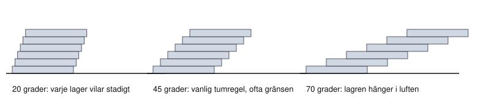

# Kapitel 4: 3D-utskrift

> **I det här kapitlet lär du dig**
> - hur en FDM-skrivare bygger upp en detalj lager för lager
> - vad slicern gör och vilka inställningar som betyder mest
> - hur du konstruerar så att detaljen går att skriva ut
> - hur du räknar på materialåtgång och passform
> - hur du testar och förbättrar en prototyp

Efter CAD-momentet finns din hållare bara som ett antal siffror i en dator. Några timmar senare kan du hålla den i handen, och då visar det sig om du tänkte rätt. Det är få tekniker som ger så snabb återkoppling från verkligheten som 3D-utskrift.

## Så fungerar FDM

Skolans skrivare är från Bambu Lab och använder tekniken **FDM**, Fused Deposition Modeling. Plast i form av en tråd, **filament**, matas in i ett hett munstycke, smälter och läggs ut i tunna strängar. När ett lager är klart flyttas byggplattan och nästa lager läggs ovanpå.

Tre saker följer direkt av den metoden:

1. Detaljen är uppbyggd av **lager**, och fogarna mellan lagren är ofta svagare än materialet längs strängarna.
2. Varje lager måste ha något att vila på, annars hänger plasten i luften.
3. Plasten krymper när den svalnar, så mått blir sällan exakta.

Vanligast är plasten **PLA**. Den är lätt att skriva ut och kräver inte lika hög temperatur som många andra plaster. Tillverkarens datablad anger värden för varje sort, och där hittar du också rekommenderade temperaturer. PLA blir mjuk redan vid ungefär 60 °C, så en hållare i PLA är inget för en bil som står i solen.

## Från modell till utskrift

I Onshape högerklickar du på delen i Parts-listan, väljer **Export** och sätter **Format** till STL eller 3MF. Välj också **Millimeter** under **Units** för STL, så att storleken blir rätt. Filen laddas ned via webbläsaren, och du öppnar den sedan i slicern.

**Slicern** är programmet som skivar upp modellen i lager och räknar ut exakt hur munstycket ska röra sig. Vi använder [Bambu Studio](https://bambulab.com/en/download/studio). Där gör du dina viktigaste val.

| Inställning | Vad den styr | Effekt |
|-------------|--------------|--------|
| Orientering | Hur detaljen ligger på plattan | Hållfasthet, support, ytkvalitet |
| Lagerhöjd | Hur tjockt varje lager är | Tunnare ger finare yta men längre tid |
| Väggar | Hur många strängar ytterkanten har | Styrka och styvhet |
| Fyllnad (infill) | Hur tätt insidan fylls | Vikt, tid och styrka |
| Support | Stödmaterial under överhäng | Går åt material och lämnar märken |
| Brim | Extra kant mot plattan | Bättre fäste så att detaljen inte släpper |

Slicern visar uppskattad tid och materialåtgång. Använd det för att jämföra alternativ innan du skriver ut. I hållaruppgiften får du högst två utskrifter, så du måste tänka först och skriva ut sedan.

## Konstruera för utskrift

Att anpassa en konstruktion till hur den ska tillverkas kallas att konstruera för tillverkning. Fråga dig:

- **Finns överhäng?** En tumregel är att vinklar upp till ungefär 45 grader från lodlinjen går bra utan support. Blir det brantare behövs stöd eller en annan orientering.
- **Finns stort plant underlag?** En stor kontaktyta mot plattan gör att detaljen sitter kvar.
- **Är väggarna tillräckligt tjocka?** Med ett munstycke på 0,4 mm läggs strängar som är ungefär 0,4 mm breda. En vägg på 2 mm motsvarar 2 / 0,4 = 5 strängar. Väggar tunnare än några strängar blir svaga.
- **Åt vilket håll ska kraften gå?** Lägg detaljen så att viktiga krafter går längs strängarna, inte försöker dra isär lagren.

Figuren visar varför vinkeln spelar roll. Varje nytt lager hänger lite utanför det förra. Vid liten vinkel bär lagret under, vid stor vinkel saknas stöd.

## Räkna på utskriften

**Genomräknat exempel.** Hållaren från kapitel 3 har volymen 5 358 mm³ = 5,358 cm³ och är 12 mm hög i sin högsta punkt.

- Antal lager med lagerhöjden 0,2 mm: 12 / 0,2 = **60 lager**.
- Massa om den skrivs ut helt tät med PLA, som har en densitet på omkring 1,24 g/cm³: 5,358 · 1,24 ≈ **6,6 g**.
- Filament med diametern 1,75 mm har tvärsnittsarean π · 0,875² ≈ 2,405 mm². Längd filament: 5 358 / 2,405 ≈ 2 228 mm ≈ **2,2 m**.

Är det rimligt? En rulle med 1 kg filament räcker till många sådana detaljer, så 6,6 g låter inte konstigt. Med fyllnad under 100 procent används mindre, men väggarna skrivs ju ändå täta, så det blir inte hälften så lite om detaljen är tunnväggig.

**Passform.** Om ett kort är 58,0 mm brett (ett påhittat mått) och du vill lämna 0,2 mm spel på varje sida behöver fickan vara 58,0 + 2 · 0,2 = **58,4 mm** bred. Rätt spel beror på skrivaren, materialet och orienteringen. Därför är just en första utskrift ett test, inte ett misslyckande.

## Från prototyp till förbättring

Testa din utskrift mot kraven och skriv ned resultatet. Passar korten? Går alla anslutningar att nå? Finns tumgreppet där du tänkte? Sedan justerar du modellen. Här syns processen från kapitel 1 på riktigt: prototyp, test och förbättring.

Var försiktig vid skrivaren. Munstycke och byggplatta är mycket varma, så stick inte in händerna under utskrift och låt detaljen svalna innan du tar loss den. Följ tillverkarens instruktioner och lärarens anvisningar.

## Begrepp

- **FDM:** utskrift där smält plast läggs i lager.
- **Filament:** plasttråd som matas in i skrivaren.
- **Slicer:** program som gör om en modell till verktygsbanor.
- **Lagerhöjd:** tjockleken på ett lager.
- **Fyllnad (infill):** hur tätt insidan fylls.
- **Överhäng:** del som hänger ut över det underliggande lagret.
- **Support:** stödmaterial som tas bort efteråt.
- **Spel:** avsiktligt mellanrum mellan två delar.

## Testa dig själv

1. Varför är en utskrift ofta svagare i höjdled än längs lagren?
2. Vad händer om du väljer 0,1 mm i stället för 0,2 mm i lagerhöjd?
3. Varför kan en annan orientering spara support?
4. Vad kan fyllnad och väggar göra för en detalj som du inte vill ska bli tung?
5. Varför är det dumt att skriva ut en detalj utan att först kontrollera den i slicern?
6. Varför behövs spel i en passning?

## Koppling till projektet

3D-utskriften avslutar [Ritteknik, CAD och 3D-print](../projekt/ritteknik-cad-3d-print/README.md). Samma kunskap använder du när du anpassar hållaren i [I hetaste laget](../projekt/hetaste-laget/README.md) och när du skriver ut axelkoppling, motorhållare och servohållare i [Driverbot](../projekt/produktutveckling-driverbot/README.md).

## Läs mer

- [Bambu Lab Wiki](https://wiki.bambulab.com/en/home): guider och felsökning.
- [Bambu PLA Basic datablad](https://cdn.shopify.com/s/files/1/0380/5149/files/Bambu_PLA_Basic_Technical_Data_Sheet.pdf): tillverkarens värden för materialet.

[← Föregående](03-cad-i-onshape.md) | [Innehåll](../README.md) | [Nästa →](05-material-och-hallbarhet.md)
