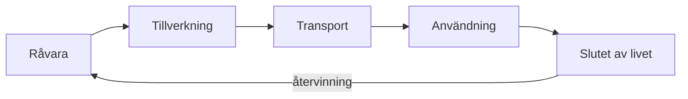

# Kapitel 5: Material och hållbarhet

> **I det här kapitlet lär du dig**
> - vilka egenskaper som avgör valet av material
> - hur du räknar enkelt på massa och hållfasthet
> - vad en livscykelanalys är
> - hur du värderar en teknisk lösning utifrån hållbarhet
> - vilken roll du som tekniker har i ett hållbart samhälle

Varför är cykelramar av aluminium, stekpannor av gjutjärn och mobilskal av plast? Inget av det är en slump. Varje material har egenskaper som passar vissa uppgifter och inte andra. Samtidigt lämnar varje materialval spår, från gruvan eller oljekällan till soptippen.

## Materialens egenskaper

När du väljer material jämför du egenskaper:

- **Densitet:** hur mycket materialet väger per volym.
- **Hållfasthet:** hur stor kraft materialet tål innan det går sönder.
- **Styvhet:** hur mycket det böjer sig under belastning.
- **Temperaturtålighet:** vid vilken temperatur det blir mjukt eller smälter.
- **Elektrisk ledningsförmåga:** om det leder ström eller isolerar.
- **Pris och tillgång**, och hur lätt materialet går att återvinna.

Tabellen visar ungefärliga värden. Verkliga värden varierar mellan olika legeringar, tillverkare och tillverkningsmetoder, så kontrollera alltid databladet för just ditt material.

| Material | Densitet (g/cm³) | Typisk användning | Styrkor | Svagheter |
|----------|-----------------:|-------------------|---------|-----------|
| Stål | ca 7,85 | Balkar, verktyg, axlar | Starkt, styvt, återvinningsbart | Tungt, kan rosta |
| Aluminium | ca 2,7 | Ramar, profiler, kylflänsar | Lätt, leder värme väl | Dyrare, mjukare än stål |
| Koppar | ca 8,9 | Ledare i kablar och kretskort | Leder ström mycket bra | Dyrt, tungt |
| PLA | ca 1,24 | 3D-utskrifter | Lätt att skriva ut | Blir mjukt vid cirka 60 °C |
| ABS | ca 1,05 | Mobilskal, Legoklossar | Slagtåligt, tål mer värme | Svårare att skriva ut |
| Trä | varierar | Möbler, byggnader | Förnybart, starkt längs fibrerna | Påverkas av fukt |

**Genomräknat exempel: massa.** Hållaren från kapitel 3 har volymen 5,358 cm³. Formeln är massa = volym · densitet.

- I stål: 5,358 · 7,85 ≈ **42,1 g**
- I aluminium: 5,358 · 2,7 ≈ **14,5 g**
- I PLA: 5,358 · 1,24 ≈ **6,6 g**

För en liten bil som ska orka bära sin egen vikt spelar den skillnaden roll.

## Att räkna på hållfasthet

**Spänning** i materialet (inte att förväxla med elektrisk spänning) är kraft per ytenhet: σ = F / A. Enheten är N/mm², vilket är samma sak som MPa.

**Genomräknat exempel.** Ett tumgrepp är 10 mm brett och 2 mm tjockt. Du drar i det med 20 N rakt utåt.

- Tvärsnittsarea: A = 10 · 2 = 20 mm².
- Spänning: σ = 20 / 20 = **1 MPa**.

Plast tål tiotals MPa, så det är inga problem. Men om du i stället trycker på tumgreppets ände blir det **böjning**, och böjning är mycket mer krävande. Om greppet sticker ut 15 mm får du ett böjande moment M = F · L = 20 · 15 = 300 Nmm. För ett rektangulärt tvärsnitt är böjmotståndet W = b · h² / 6 = 10 · 2² / 6 ≈ 6,67 mm³. Spänningen blir σ = M / W = 300 / 6,67 ≈ **45 MPa**.

Samma kraft ger alltså 45 gånger större spänning vid böjning. Fördubblar du tjockleken till 4 mm blir W = 10 · 4² / 6 ≈ 26,7 mm³ och spänningen sjunker till ungefär **11 MPa**, en fjärdedel. Tjockleken räknas i kvadrat, och därför är det ofta effektivare att göra en detalj tjockare än bredare. Hållfasthetslära är ett stort område, men de här formlerna räcker långt för en rimlighetsbedömning.

## Livscykeln

En **livscykelanalys**, LCA, är en metod för att undersöka en produkts miljöpåverkan under hela livet: råvara, tillverkning, transport, användning och slutet av livet. Metoden beskrivs i standarden ISO 14040.

Det intressanta är att påverkan kan ligga på oväntat ställe. För en elbil eller en dator ligger mycket i tillverkningen, medan en elradiator framför allt påverkar under användningen. Rätt åtgärd beror på var i kedjan påverkan är störst.

Tre saker är värda att fundera på när det gäller PLA. PLA tillverkas oftast av växtbaserad råvara, men det betyder inte att plasten bryts ned av sig självt i naturen eller i en vanlig kompost. Bambu Labs datablad beskriver den som nedbrytbar under vissa konstgjorda komposteringsförhållanden, vilket är något helt annat än att den försvinner i naturen. Dessutom är plastens väg efter användning inte självklar, så det bästa är ofta att göra rätt från början och slösa mindre: skriv inte ut i onödan, undvik onödigt stöd och fundera på om detaljen behövs.

**Genomräknat exempel.** En skrivare drar i genomsnitt 100 W (ett antagande) under en utskrift på 1,5 timmar. Energin är W = P · t = 0,1 kW · 1,5 h = **0,15 kWh**. Det är mycket lite jämfört med en elbil eller ett elelement, men den stora påverkan kan ligga i det material som produceras och i misslyckade utskrifter.

Elektronikavfall är en av världens snabbast växande avfallsströmmar. FN:s rapport Global E-waste Monitor 2024 anger 62 miljoner ton år 2022, och att ungefär 22 procent av detta dokumenterats som insamlat och återvunnet. Siffrorna uppdateras, så se källan för de senaste uppgifterna.

## Hållbar utveckling i praktiken

**Hållbar utveckling** brukar delas in i tre dimensioner, och alla tre finns med i kursens betygskriterier:

- **Miljömässig:** resurser, utsläpp, avfall.
- **Ekonomisk:** kostnad, livslängd, reparerbarhet.
- **Social:** arbetsvillkor, hälsa, tillgänglighet, rättvisa.

Att värdera en lösning betyder att väga dessa mot varandra. En lösning kan vara billig men ge mycket avfall, eller klimatsmart men oåtkomlig för den som inte har råd. Använd gärna en viktad beslutsmatris från kapitel 1 med hållbarhet som kriterium.

Som **tekniker** påverkar du mycket av detta genom dina val. Går produkten att reparera? Kan delarna bytas? Vilket material går att återvinna? Att ställa de frågorna tidigt är en del av yrket.

## Begrepp

- **Densitet:** massa per volym.
- **Hållfasthet:** ett materials förmåga att tåla belastning.
- **Spänning (mekanisk):** kraft per ytenhet, σ = F / A.
- **Böjning:** belastning som kröker en detalj.
- **Livscykelanalys:** undersökning av miljöpåverkan under en produkts hela liv.
- **Hållbar utveckling:** utveckling som tar hänsyn till miljö, ekonomi och människor.

## Testa dig själv

1. Vilka tre egenskaper är viktigast för en hållare till ett kretskort i en bil, och varför?
2. Varför används koppar och inte stål i elektriska ledare, trots att koppar är dyrare?
3. Varför är det missvisande att säga att PLA är "bra för miljön" utan vidare förklaring?
4. Varför ger böjning större spänning än dragning?
5. Vad betyder att en produkt har stor påverkan under användningen?
6. Ge ett exempel på en lösning som är bra ekonomiskt men dålig socialt.

## Övningar

**Grund.** En detalj har volymen 12 cm³. Vad väger den i aluminium och i ABS?

Svar

Aluminium: 12 · 2,7 = 32,4 g. ABS: 12 · 1,05 = 12,6 g.

**Vidare.** Ett tumgrepp är 10 mm brett, 3 mm tjockt och sticker ut 15 mm. Vilken spänning blir det av en kraft på 20 N i änden?

Svar

M = 300 Nmm. W = 10 · 3² / 6 = 15 mm³. σ = 300 / 15 = 20 MPa.

**Utmaning.** Gör en förenklad livscykelanalys av din hållare. Beskriv råvara, tillverkning, användning och slut. Var är påverkan störst, tror du, och vad kan du ändra i konstruktionen för att minska den?

## Koppling till projektet

I [Ritteknik, CAD och 3D-print](../projekt/ritteknik-cad-3d-print/README.md) väljer du vägg, fyllnad och orientering, och du kan använda beräkningarna här för att motivera dina val. I [Driverbot](../projekt/produktutveckling-driverbot/README.md) utvärderar du din bil, och då är hållbarhet ett av perspektiven.

## Läs mer

- [Naturvårdsverket om avfall](https://www.naturvardsverket.se/amnesomraden/avfall/)
- [Global E-waste Monitor 2024](https://www.unitar.org/about/news-stories/press/global-e-waste-monitor-2024-electronic-waste-rising-five-times-faster-documented-e-waste-recycling)
- [Globala målen](https://globalamalen.se)

[← Föregående](04-3d-utskrift.md) | [Innehåll](../README.md) | [Nästa →](06-mikrodatorn.md)
