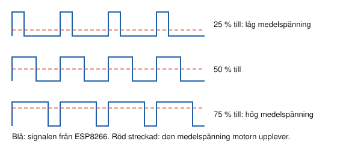
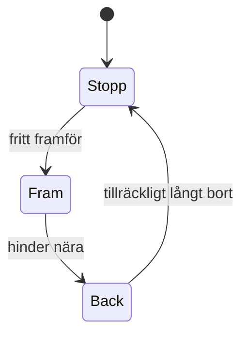

# Kapitel 6: Mikrodatorn och programmering

> **I det här kapitlet lär du dig**
> - hur en mikrodator är uppbyggd och hur ESP8266 kopplas in
> - skillnaden mellan pinne, signal och mjukvarureferens
> - digitala och analoga signaler, I2C och PWM
> - hur du strukturerar programkod med funktioner och tillstånd
> - hur du felsöker systematiskt

En tvättmaskin, en bilnyckel och en elsparkcykel har en sak gemensamt: inuti sitter en liten dator som läser av något och styr något annat. När du förstått hur det går till kan du bygga egna saker som känner av världen och gör något åt den. I det här momentet går du från en blinkande lysdiod till en motor som styrs av knapp och potentiometer.

## Mikrodatorn

En **mikrodator** (eller mikrokontroller) är en liten dator på ett enda chip, med processor, minne och in- och utgångar. Vi använder **ESP8266** på ett kort av typen NodeMCU. Den har dessutom inbyggt Wi-Fi, och det är därför vi kan koppla upp den mot internet senare.

Programmet skriver du i **Arduino IDE**. IDE står för Integrated Development Environment, en utvecklingsmiljö. Arbetsflödet är alltid detsamma:


När du trycker på Verify **kompileras** koden. Det betyder att programmet kontrolleras språkligt och översätts till ettor och nollor som kortets processor kan köra. Verify hittar språkliga fel men inte logiska fel. Ett program som kompilerar kan alltså ändå göra helt fel sak.

## Kursens sju labbar

| Labb | Innehåll | Material |
|------|----------|----------|
| 1 | Installation och Blink | [Labb 1](../Mikrodator/1%20Installation%20av%20Arduino%20IDE%20och%20komma%20ig%C3%A5ng%20med%20ESP8266-VW19117.docx) |
| 2 | Bibliotek och AM2320-givaren | [Labb 2](../Mikrodator/2%20L%C3%A4gga%20till%20bibliotek%20%20i%20Arduino%20IDE%20och%20m%C3%A4ta%20temperatur%20med%20AM2320.docx) |
| 3 | Tryckknapp på digital ingång | [Labb 3](../Mikrodator/3%20Koppla%20in%20trycknapp%20till%20digital%20ing%C3%A5mg.docx) |
| 4 | OLED-display | [Labb 4](../Mikrodator/4%20Skriva%20till%20en%20Display.docx) |
| 5 | Avståndssensor VL53L0X | [Labb 5](../Mikrodator/5%20Avst%C3%A5ndsensor%20VLX53L0X.docx) |
| 6 | Servo och potentiometer | [Labb 6](../Mikrodator/6%20Servo.docx) |
| 7 | Motorstyrning | [Labb 7](../Mikrodator/7%20Motorstyrning.docx) |

Efter varje labb gäller samma fyra steg: få det att fungera, förstå koden, ändra något, kommentera din kod. Färdiga exempel finns i [Koder](../Mikrodator/Koder/).

## Pinne, signal och mjukvarureferens

Tre ord är lätta att blanda ihop:

- **Pinne:** den fysiska anslutningen på kortet, till exempel D5.
- **Signal:** det pinnen kan användas till, till exempel SDA.
- **Mjukvarureferens:** det pinnen heter i programmet, till exempel GPIO 14.

| Märkt på kortet | GPIO i programmet | Använd i labbarna till |
|-----------------|-------------------|------------------------|
| D1 / D2 | 5 / 4 | Motorernas varvtal, servo (D2) |
| D3 / D4 | 0 / 2 | Motorernas riktning |
| D5 / D6 | 14 / 12 | I2C: SDA och SCL |
| D7 | 13 | Tryckknapp |
| A0 | analog ingång | Potentiometer |

Dra alltid ur USB-kabeln innan du kopplar om, och kontrollera att komponenterna får rätt spänning. Kortets signaler arbetar med 3,3 V.

## Signaler

En **digital signal** har bara två lägen, av eller på. En tryckknapp läses med `digitalRead()`.

En **analog signal** kan anta alla värden mellan två gränser. Mikrodatorn omvandlar den till ett tal med en A/D-omvandlare. På ESP8266 är omvandlaren 10 bitar, så talen går från 0 till 2¹⁰ − 1 = 1023.

**Genomräknat exempel.** I labb 6 motsvarar 1,0 V på ingången värdet 1023. Den minsta förändring omvandlaren kan se är 1,0 V / 1023 ≈ 0,98 mV, alltså ungefär 1 mV. Vill du göra om ett potentiometervärde till en servovinkel använder du `map(varde, 0, 1023, 0, 180)`. Värdet 512 ger 512 · 180 / 1023 ≈ 90 grader, vilket stämmer eftersom 512 ligger ungefär mitt i intervallet.

**I2C** är en seriebuss, det vill säga ett sätt att skicka data bit för bit över få ledningar. Den använder SDA för data och SCL för klockan. Flera enheter kan dela på samma två ledningar, eftersom de har olika adresser. Displayen i labb 4 har till exempel adressen `0x3C`.

**PWM**, pulsbreddsmodulering, används för att styra effekt med en digital utgång. Utgången slås av och på mycket snabbt, och andelen tid som den är på bestämmer medeleffekten.



> **Viktigt för labb 7.** Äldre instruktioner använder värden upp till 1023 i `analogWrite()`. Från version 3.0 av ESP8266-stödet till Arduino IDE är standardområdet i stället 0–255. Lägg till `analogWriteRange(1023);` i `setup()` om du vill använda kodexemplen som de är skrivna, annars ger alla värden över 255 full fart.

## Kod med struktur

Programmet har två huvuddelar. `setup()` körs en gång och `loop()` körs om och om igen. När koden växer delar du upp den i **funktioner** med beskrivande namn, använder **variabler** med tydliga namn och kommenterar *varför* du gör något.

Ett vanligt problem är `delay()`, som stoppar hela programmet. Exemplet nedan använder `millis()`, som läser hur lång tid programmet har kört, så att programmet kan göra annat under tiden.

```cpp
// Knappen på D7 växlar lampan. Utskriften sker varje sekund utan delay().
const int KNAPP = D7;                  // D7 på kortet = GPIO 13
bool lampaPa = false;                  // Vad programmet tror om lampan
bool forraKnapp = false;               // Knappens läge förra varvet
unsigned long senasteUtskrift = 0;     // Tidpunkt för senaste utskriften
const unsigned long INTERVALL = 1000;  // Millisekunder mellan utskrifter

void setup() {
  Serial.begin(9600);
  pinMode(KNAPP, INPUT);
  pinMode(LED_BUILTIN, OUTPUT);
  digitalWrite(LED_BUILTIN, HIGH);     // Inbyggda lysdioden är släckt på HIGH
}

void loop() {
  bool knapp = digitalRead(KNAPP);
  if (knapp && !forraKnapp) {          // Knappen trycktes ned just nu
    lampaPa = !lampaPa;
    digitalWrite(LED_BUILTIN, lampaPa ? LOW : HIGH);
  }
  forraKnapp = knapp;

  if (millis() - senasteUtskrift >= INTERVALL) {
    senasteUtskrift = millis();
    Serial.print("Lampan är ");
    Serial.println(lampaPa ? "tänd" : "släckt");
  }
}
```

När programmet ska göra olika saker i olika lägen är ett **tillståndsdiagram** en bra hjälp. Du beskriver vilka tillstånd som finns och vad som får programmet att byta tillstånd.



```cpp
enum Tillstand { STOPP, FRAM, BACK };
Tillstand tillstand = STOPP;

void uppdatera(int avstand) {          // Avståndet anges i millimeter
  switch (tillstand) {
    case STOPP: if (avstand > 300) tillstand = FRAM;  break;
    case FRAM:  if (avstand < 100) tillstand = BACK;  break;
    case BACK:  if (avstand > 200) tillstand = STOPP; break;
  }
}
```

## Felsökning

Fel kan finnas på tre ställen: i kopplingen, i komponenten eller i koden. Testa programmet utan givare först, så att du ser att kortet och Serial Monitor fungerar. Skriv ut värden för att se vad programmet egentligen tror. Byt komponent mot en kompis om du misstänker att den är trasig, och ändra en sak i taget.

## Begrepp

- **Mikrodator:** dator på ett chip med in- och utgångar.
- **Kompilering:** översättning av kod till något processorn kan köra.
- **Bibliotek:** färdig kod som du kan använda i ditt program.
- **Digital och analog signal:** två lägen respektive många möjliga värden.
- **I2C:** seriebuss med dataledning och klockledning.
- **PWM:** snabb av- och påslagning för att styra effekt.
- **Tillstånd:** ett läge som programmet befinner sig i.

## Koppling till projektet

Det här är innehållet i [Mikrokontroller och elektronik](../projekt/mikrokontroller-och-elektronik/README.md). Givaren och koden behöver du i [I hetaste laget](../projekt/hetaste-laget/README.md), och motorn och servot i [Driverbot](../projekt/produktutveckling-driverbot/README.md).

## Läs mer

- [Arduino Language Reference](https://www.arduino.cc/reference/en/)
- [Dokumentation för ESP8266-stödet](https://arduino-esp8266.readthedocs.io/en/latest/reference.html)
- [AM2320-biblioteket](https://github.com/hibikiledo/AM2320) och [VL53L0X-biblioteket](https://github.com/pololu/vl53l0x-arduino)
- [Adafruit SSD1306](https://adafruit.github.io/Adafruit_SSD1306/html/class_adafruit___s_s_d1306.html)

[← Föregående](05-material-och-hallbarhet.md) | [Innehåll](../README.md) | [Nästa →](07-it-system-och-matning.md)
