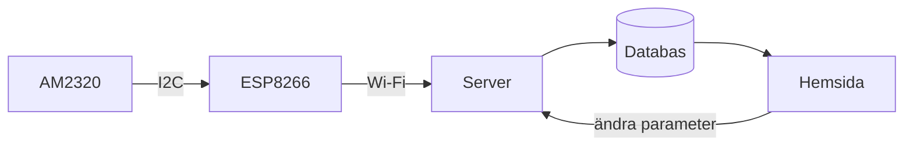

# Kapitel 7: IT-system, mätning och kommunikation

> **I det här kapitlet lär du dig**
> - hur ett IT-system är uppbyggt och vilken roll det har i teknikutveckling
> - hur en temperaturmätare hänger ihop från givare till skärm
> - vad som påverkar om en mätning går att lita på
> - hur du skriver en systembeskrivning
> - hur du presenterar teknik i film

När du tittar på en väderapp ser du en siffra. Bakom den finns en givare, en mikrodator, ett nätverk, en server, en databas och ett gränssnitt. Om något i kedjan fallerar visar appen fel eller ingenting. I det här kapitlet lär du dig att se hela kedjan, och att beskriva den så att andra förstår.

## Vad är ett IT-system?

Ett **IT-system** är en samling hårdvara, mjukvara, nätverk och data som tillsammans utför en uppgift. Det kan vara ett bankkontor på nätet, en bils motorstyrning eller din termometer.

| Del | Uppgift | Exempel i I hetaste laget |
|-----|---------|---------------------------|
| Givare | Mäter något i verkligheten | AM2320 mäter temperatur och luftfuktighet |
| Mikrodator | Läser givaren och skickar data | ESP8266 |
| Nätverk | Flyttar data | Wi-Fi och internet |
| Server och databas | Tar emot och sparar | Görs i Programmering 1 |
| Gränssnitt | Visar för människor | Hemsidan, görs i Programmering 1 |

IT-system har en central roll i dagens teknikutveckling. De gör att produkter kan mätas och uppdateras efter att de lämnat fabriken, och att data från många användare kan leda till förbättringar. De skapar också nya frågor: vem äger datan, vad händer om tjänsten stängs ned, och vad krävs för att systemet ska vara säkert?

## Bra mätningar

En mätning är aldrig helt exakt. Två ord hjälper dig att tänka rätt:

- **Noggrannhet** handlar om hur nära det sanna värdet mätningen är.
- **Upplösning** handlar om hur små steg du kan se.

Att en givare visar 22,47 °C betyder inte att den är rätt på hundradelen. Datablad för AM2320 anger en noggrannhet på ungefär ±0,5 °C vid 25 °C och en mätperiod på omkring 2 sekunder, och oberoende tester har pekat på att verkligheten kan vara sämre än så. Därför bör du inte läsa av givaren oftare än databladet tillåter, och du bör alltid fråga dig om värdet är rimligt.

Så här kan du testa din termometer:

1. Jämför med en annan termometer och skriv ned skillnaden.
2. Håll fingret på givaren. Stiger temperaturen?
3. Låt den ligga stilla i fem minuter och titta på om värdena varierar.
4. Ta medelvärdet av flera mätningar om värdena hoppar.

**Genomräknat exempel: datamängd.** Termometern skickar ett värde var tionde minut, och varje rad i databasen tar ungefär 16 byte (ett antagande).

- Antal mätningar per dygn: 24 · 6 = **144**.
- Antal mätningar per år: 144 · 365 = **52 560**.
- Datamängd per år: 52 560 · 16 = 840 960 byte, ungefär **0,84 MB**.

Det är mycket lite. Vill du i stället mäta varje sekund blir det 600 gånger så mycket, och då börjar frågan om vad du egentligen behöver bli intressant.

## Säkerhet

En uppkopplad enhet är en dörr in i ett nätverk. Tre enkla regler:

- Lägg aldrig Wi-Fi-lösenord eller andra hemligheter i kod som är publik, till exempel på GitHub. Skriv dem i en separat fil som inte delas.
- Skicka inte mer data än du behöver.
- Tänk på att mätdata kan avslöja saker. Temperatur och luftfuktighet i ett rum kan säga något om när någon är hemma.

## Systembeskrivning

En **systembeskrivning** förklarar hur en lösning är uppbyggd, så att någon annan kan förstå, använda eller vidareutveckla den. En bra systembeskrivning innehåller:

1. Syfte: vad systemet gör och för vem.
2. Översiktsbild: ett blockschema över delarna.
3. Hårdvara: komponenter, kopplingar och spänningar.
4. Mjukvara: vad koden gör, gärna med tillståndsdiagram.
5. Dataflöde: vad som skickas, hur ofta och vart.
6. Test: hur du kontrollerat att det fungerar och vilka resultat du fick.
7. Begränsningar och förslag på förbättringar.

Skriv för en läsare som vet lite om teknik men inget om just ditt projekt. Rita gärna blockscheman, för en bra bild förklarar ofta mer än en sida text.

## Att presentera i film

I hetaste laget redovisas med en film på ungefär 5 minuter. Att kommunicera teknik är en förmåga i sig, och kursplanen tar upp både muntlig och skriftlig kommunikation med digitala medier.

Lägg upp filmen ungefär så här:

- Intresseväckande inledning
- Kort presentation av projektet och syftet
- Hemsidan
- Systembeskrivning
- Din programmering
- Hållaren i Onshape
- Hållaren färdigutskriven med komponenter
- Summering

**Röst och manus.** Skriv ett talmanus och läs det högt. Om du talar med en hastighet på ungefär 140 ord per minut räcker fem minuter till cirka 5 · 140 = 700 ord. Binda ihop delarna, ta bort det som inte behövs och öva. När tittaren bara hör din röst blir betoning, variation, pauser och engagemang extra viktiga.

**Målgruppen** avgör hur du förklarar. Till en kompis som läser samma kurs kan du säga "I2C", men till en utomstående behöver du förklara vad det är.

## Begrepp

- **IT-system:** hårdvara, mjukvara, nätverk och data som samverkar.
- **Givare:** komponent som mäter något i verkligheten.
- **Noggrannhet:** hur nära det sanna värdet en mätning ligger.
- **Upplösning:** de minsta steg som en mätning kan visa.
- **Systembeskrivning:** dokument som förklarar hur en lösning är uppbyggd.
- **Målgrupp:** de personer du riktar dig till.

## Koppling till projektet

Kapitlet är direkt kopplat till [I hetaste laget](../projekt/hetaste-laget/README.md). Där lämnar du in en fungerande termometer, en systembeskrivning, kommenterad kod och en film. Du behöver också tänka på IT-säkerhet och nätverk i [Driverbot](../projekt/produktutveckling-driverbot/README.md), där bilen styrs via internet.

## Läs mer

- [Mäta temperatur med AM2320](../I%20hetaste%20laget/M%C3%A4ta%20temperatur%20med%20AM2320.docx)
- [I hetaste laget: presentation](../I%20hetaste%20laget/I%20hetaste%20laget.pptx)
- [Programmering 1](https://github.com/abbindustrigymnasium/programmering1): kursen du samläser med.
- [AM2320 hos Adafruit](https://www.adafruit.com/product/3721): produktbeskrivning med kritiska kommentarer om noggrannheten.

[← Föregående](06-mikrodatorn.md) | [Innehåll](../README.md) | [Nästa →](08-ellara.md)
