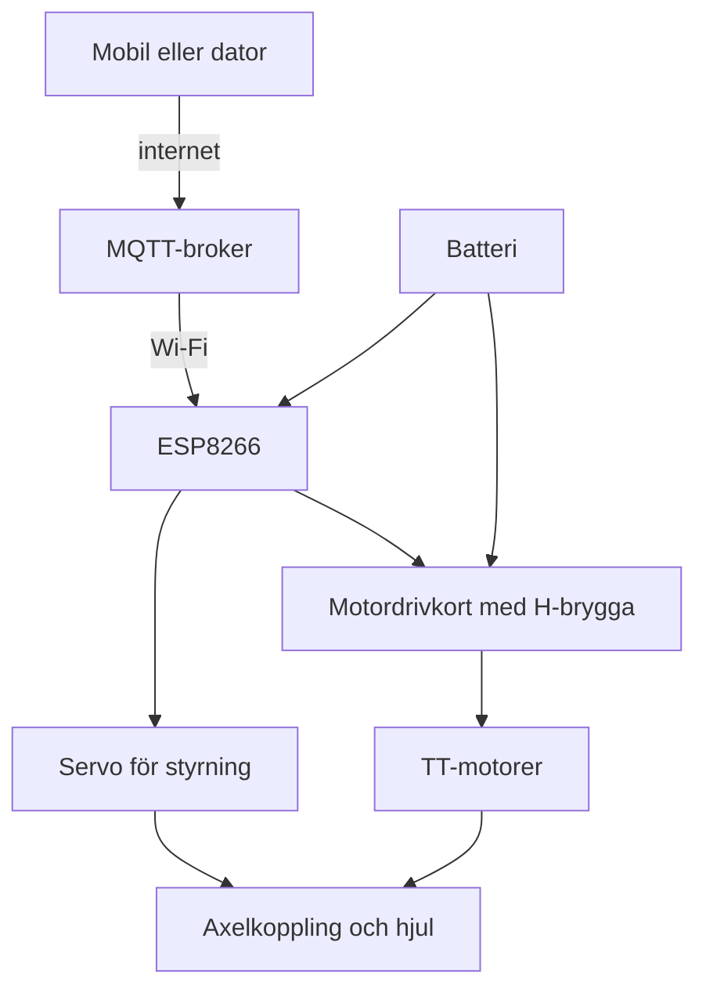
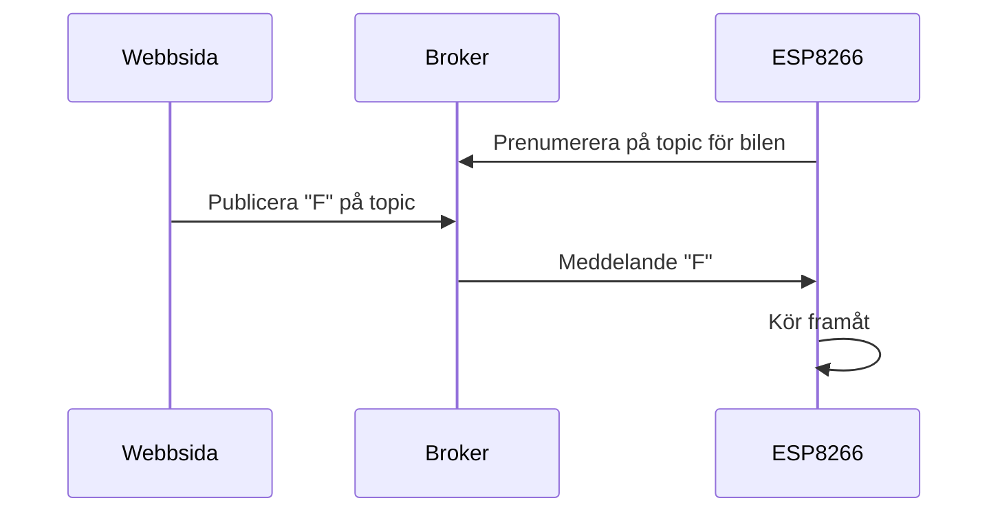

# Kapitel 9: Konstruktion av en robotbil

> **I det här kapitlet lär du dig**
> - hur en robotbil är uppbyggd som ett system av mekanik, el och kod
> - hur du räknar på hastighet, kraft, moment och batteritid
> - hur H-bryggan och servot styr bilen
> - hur bilen styrs via internet med MQTT
> - hur du testar och verifierar en konstruktion

Kursens sista projekt samlar allt: du ritar delar i CAD, skriver ut dem, kopplar elektronik, skriver kod och får bilen att röra sig. Det svåra är inte någon enskild del utan att allt ska fungera tillsammans. En perfekt motorhållare hjälper inte om axeln glappar, och perfekt kod hjälper inte om batteriet inte orkar.

## Bilen som system

Ett **system** är delar som samverkar för att uppnå något. Robotbilen består av flera delsystem:



När något går fel behöver du kunna ringa in i vilket delsystem felet finns. Det är samma strategi som i kapitel 1, men med fler möjliga felkällor.

## Räkna på bilen

Att räkna före sparar utskrifter. Formlerna är enkla, men kräver att du håller reda på enheterna. Värdena nedan är exempel, så ta fram dina egna från datablad eller mätningar.

**Hastighet.** Ett hjul med diametern d snurrar n varv per minut. Under en minut rullar bilen n varv gånger hjulets omkrets, så hastigheten är v = π · d · n / 60.

Med d = 0,065 m och n = 150 varv per minut:

v = π · 0,065 · 150 / 60 ≈ **0,51 m/s**, vilket är ungefär **1,8 km/h**. Det känns rimligt för en liten robotbil, ungefär som långsam gång.

**Kraft och moment.** Ett **moment** är en vridande kraft, och T = F · r. Hur mycket moment behövs för att bilen ska accelerera?

- Bilen väger 0,6 kg och ska accelerera med 1 m/s². Kraft: F = m · a = 0,6 · 1 = 0,6 N.
- Kraften fördelas på två drivande hjul, alltså 0,3 N per hjul.
- Med hjulradien 0,0325 m blir momentet per hjul T = 0,3 · 0,0325 ≈ **0,0098 Nm**, ungefär 10 mNm.

Om motorn efter växellådan kan ge ungefär 100 mNm har du ungefär 10 gångers marginal. Marginalen behövs för att friktionen, ojämnt golv och start från stillastående kräver mer än den enkla räkningen visar.

**Batteritid.** Om bilen drar 0,6 A i snitt och batteriet rymmer 2 000 mAh blir tiden 2 000 / 600 ≈ **3,3 timmar**. I verkligheten blir det kortare, eftersom strömmen varierar och batteriet inte kan ge ut hela sin kapacitet.

**Styrning.** Hur snävt svänger bilen? För en bil med hjulbas L, avståndet mellan axlarna, och styrvinkeln δ gäller ungefär R = L / tan(δ). Med L = 120 mm och δ = 25° blir svängradien R = 120 / tan(25°) ≈ **257 mm**.

## Motorer och styrning

Motorerna styrs med kretsen du mötte i labb 7. En **H-brygga** består av transistorer som kopplas korsvis. Genom att slå till olika par går strömmen åt ena eller andra hållet genom motorn, och motorn byter rotationsriktning. Varvtalet styrs med PWM, som du lärde dig i kapitel 6.

| Funktion | Motor A | Motor B |
|----------|---------|---------|
| Varvtal (PWM) | D1, GPIO 5 | D2, GPIO 4 |
| Riktning | D3, GPIO 0 | D4, GPIO 2 |

```cpp
const int MOTOR_A_FART = D1;      // PWM: hur snabbt
const int MOTOR_A_RIKTNING = D3;  // HIGH eller LOW: åt vilket håll

void setup() {
  analogWriteRange(1023);         // Nyare ESP8266-stöd använder annars 0-255
  pinMode(MOTOR_A_FART, OUTPUT);
  pinMode(MOTOR_A_RIKTNING, OUTPUT);
}

void kor(int fart, bool framat) {
  digitalWrite(MOTOR_A_RIKTNING, framat ? HIGH : LOW);
  analogWrite(MOTOR_A_FART, fart);
}

void loop() {
  kor(700, true);                 // Testa vilket håll som är framåt på din bil
}
```

Ett **servo** är en motor som själv håller en vinkel. Du anger en vinkel med `servot.write(90)`. Eftersom pinnarna D1 till D4 används av motordrivkortet i labb 7, medan servokopplingen i labb 6 använder D2, måste du kontrollera vilka pinnar som är lediga när allt ska fungera samtidigt. Rita ett kopplingsschema innan du sätter ihop allt.

## Styrning över internet med MQTT

**MQTT** är ett enkelt sätt för enheter att skicka meddelanden till varandra. Det bygger på en **broker**, en server som tar emot alla meddelanden och skickar dem vidare. Avsändare **publicerar** på ett ämne, en **topic**, och mottagare **prenumererar** på samma topic.



I projektet får du färdig kod till det här. Principen är att bilen kör en funktion varje gång ett meddelande kommer in, ungefär så här (den färdiga koden kan se annorlunda ut):

```cpp
void meddelande(char* topic, byte* data, unsigned int langd) {
  if (langd == 0) return;
  char kommando = (char)data[0];
  if (kommando == 'F') kor(700, true);
  else if (kommando == 'B') kor(700, false);
  else kor(0, true);
}
```

Tänk på säkerheten: uppgifter för att logga in på en broker ska aldrig läggas i publik kod.

## Test och verifiering

Att **verifiera** är att kontrollera att konstruktionen uppfyller kraven. Skriv testerna innan du testar, så att du inte anpassar kraven efter resultatet. Exempel på testprotokoll:

| Krav | Test | Förväntat | Resultat | Åtgärd |
|------|------|-----------|----------|--------|
| Kör fram och back | Kör koden tio gånger | Inga stopp | Stannar 2 av 10 | Kontrollera batteriet |
| Svänger | Mät svängradien | Under 300 mm | 270 mm | Godkänt |
| Max 150 × 150 × 150 mm | Mät | Får plats | 148 mm | Godkänt |

Testa delsystem för sig innan du sätter ihop dem, och ta bort ett hjul eller lyft bilen när du provar motorn första gången. Fundera också på utvärdering. Hur mycket material gick åt? Vilka delar går att återanvända när bilen plockas isär? Hur påverkar bilens design vem som kan använda den?

## Begrepp

- **System:** delar som samverkar för att uppnå något.
- **Moment:** vridande kraft, T = F · r.
- **H-brygga:** transistorkoppling som kan vända strömriktningen.
- **Servo:** motor som håller en bestämd vinkel.
- **MQTT:** protokoll för meddelanden via en broker.
- **Topic:** ämne som meddelanden skickas på.
- **Verifiering:** kontroll av att krav är uppfyllda.

## Koppling till projektet

Allt i kapitlet används i [Produktutveckling: Driverbot](../projekt/produktutveckling-driverbot/README.md). Kapitel 3 och 4 ger dig CAD och utskrift, kapitel 6 motorstyrningen, kapitel 7 nätverk och säkerhet och kapitel 8 beräkningarna.

## Läs mer

- [Materialet för Driverbot](../Driverbot/) med CAD-filer och arbetsordning.
- [Filmen om motorhållaren](../Driverbot/1.%20Motorh%C3%A5llare%20instruktion.mp4)
- [MQTT.org](https://mqtt.org)
- [PubSubClient, ett MQTT-bibliotek för Arduino](https://github.com/knolleary/pubsubclient)

[← Föregående](08-ellara.md) | [Innehåll](../README.md) | [Nästa →](10-teknik-samhalle-normer.md)
